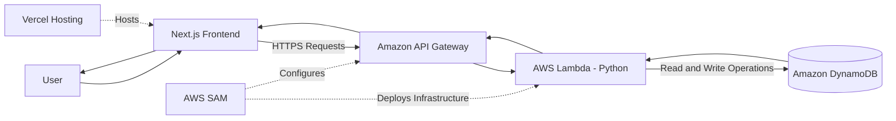
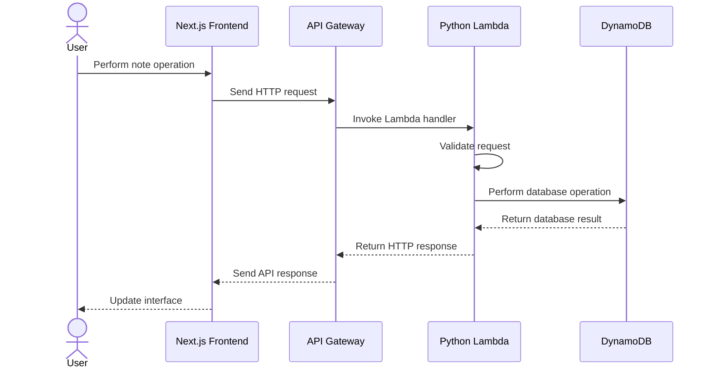

# Project Architecture

### 1. Introduction

CloudNotes follows a **serverless full-stack architecture** that separates the frontend, backend processing, API communication, and database storage.

The application uses Next.js for the frontend, Python AWS Lambda for backend processing, Amazon API Gateway for HTTP communication, and Amazon DynamoDB for persistent data storage.

The frontend is hosted on Vercel, while the backend infrastructure runs on Amazon Web Services (AWS).

This architecture provides a separation of responsibilities between the user interface, business logic, and data storage.

### 2. High-Level System Architecture

The following diagram illustrates the overall architecture of CloudNotes.



#### Architecture Overview

1. The user accesses CloudNotes through the deployed web application.
2. Vercel serves the Next.js frontend.
3. The frontend sends HTTP requests to Amazon API Gateway.
4. API Gateway routes requests to the Python Lambda function.
5. Lambda processes the requested operation.
6. DynamoDB stores or retrieves the requested note data.
7. The backend returns a response through API Gateway.
8. The frontend displays the result to the user.

### 3. Architecture Components

#### 3.1 Frontend Layer

**Technology:** Next.js and TypeScript

The frontend provides the user interface for interacting with CloudNotes.

Responsibilities:

* Display the notes workspace.
* Allow users to create notes.
* Display saved notes.
* Support note editing and deletion.
* Send API requests to the backend.
* Display API responses and application states.

**Hosting Platform:** Vercel

#### 3.2 API Layer

**Technology:** Amazon API Gateway

Amazon API Gateway provides the HTTP interface between the frontend and backend.

The API receives requests and routes them to the configured AWS Lambda function.

Responsibilities:

* Receive HTTP requests.
* Route requests to Lambda.
* Support application API methods.
* Handle cross-origin resource sharing (CORS) configuration.
* Return backend responses to the frontend.

#### 3.3 Backend Layer

**Technology:** Python AWS Lambda

AWS Lambda executes the backend application logic without requiring a continuously running server.

The Lambda handler is implemented in:

```
hello_world/app.py
```

Handler configuration:

```
app.lambda_handler
```

Responsibilities:

* Process incoming API Gateway events.
* Read request headers and request bodies.
* Validate incoming data.
* Identify the visitor using the `X-User-Id` header.
* Perform note operations.
* Communicate with DynamoDB.
* Return HTTP responses.

#### 3.4 Database Layer

**Technology:** Amazon DynamoDB

Amazon DynamoDB is used for persistent note storage.

The application uses a DynamoDB table named:

```
CloudNotes
```

Table configuration:

| Attribute     | Configuration |
| ------------- | ------------- |
| Table Name    | CloudNotes    |
| Partition Key | id            |
| Key Type      | String        |
| Database Type | NoSQL         |

The backend uses Boto3 to communicate with DynamoDB.

Stored note attributes include:

* `id`
* `userId`
* `title`
* `content`

The `userId` attribute is used to associate notes with a visitor identifier.

### 4. Application Request Flow

CloudNotes processes application requests through the following flow:



#### Request Processing Steps

1. A user performs an action in the CloudNotes interface.
2. The frontend creates an HTTP request.
3. The request is sent to the API Gateway endpoint.
4. API Gateway invokes the configured Lambda function.
5. Lambda validates the request and processes the operation.
6. The backend interacts with DynamoDB when required.
7. Lambda generates an HTTP response.
8. API Gateway forwards the response to the frontend.
9. The frontend updates the user interface.

### 5. Backend API Architecture

The application backend supports note-management operations.

| HTTP Method | Endpoint      | Operation                |
| ----------- | ------------- | ------------------------ |
| GET         | `/notes`      | Retrieve notes           |
| POST        | `/notes`      | Create a note            |
| GET         | `/notes/{id}` | Retrieve a specific note |
| PUT         | `/notes/{id}` | Update a note            |
| DELETE      | `/notes/{id}` | Delete a note            |

The API Gateway routes are defined in the AWS SAM template.

The Lambda handler processes the requests based on the HTTP method and resource path.

### 6. Note Data Flow

Each note is associated with a visitor identifier.

The backend receives this identifier through the following HTTP header:

```
X-User-Id: visitor-identifier
```

The backend uses the identifier to filter note records and check ownership before performing operations.

#### Note Storage Structure

Example DynamoDB item:

```
{
  "id": "note-123",
  "userId": "visitor-identifier",
  "title": "My First Note",
  "content": "Learning AWS serverless architecture."
}
```

The `id` attribute identifies a note, while `userId` associates it with a visitor.

**Security consideration:** The current `X-User-Id` mechanism is a visitor identifier, not secure authentication. A client can potentially change or spoof this header. Production applications requiring private user accounts should implement proper authentication and authorization.

### 7. Cloud Infrastructure Architecture

CloudNotes uses AWS Serverless Application Model (SAM) to define and deploy its backend infrastructure.

The infrastructure configuration is maintained in:

```
template.yaml
```

The template defines:

* AWS Lambda function.
* Python runtime configuration.
* API Gateway event routes.
* Lambda environment variables.
* DynamoDB access permissions.
* API Gateway CORS configuration.

#### Lambda Configuration

| Configuration        | Value                   |
| -------------------- | ----------------------- |
| Function Handler     | `app.lambda_handler`    |
| Runtime              | Python 3.14             |
| Architecture         | x86\_64                 |
| Timeout              | 30 seconds              |
| Environment Variable | `TABLE_NAME=CloudNotes` |

#### IAM Permissions

The SAM template uses:

```
Policies:
  - DynamoDBCrudPolicy:
      TableName: CloudNotes
```

This provides the Lambda function with the configured DynamoDB CRUD permissions for the specified table.

The DynamoDB table itself is referenced by the template and must already exist.

### 8. Deployment Architecture

CloudNotes uses separate deployment platforms for the frontend and backend.

| Component                 | Platform           |
| ------------------------- | ------------------ |
| Frontend Hosting          | Vercel             |
| Backend Execution         | AWS Lambda         |
| API Management            | Amazon API Gateway |
| Database                  | Amazon DynamoDB    |
| Infrastructure Deployment | AWS SAM            |
| Source Code Management    | GitHub             |

#### Deployment Flow

```
flowchart TD
    G[GitHub Repository]
    G --> F[Frontend Source]
    G --> B[Backend Source]

    F --> V[Vercel Deployment]
    B --> SAM[AWS SAM Build and Deploy]

    SAM --> L[AWS Lambda]
    SAM --> API[Amazon API Gateway]
    L --> DB[(Amazon DynamoDB)]

    V --> LIVE[Live CloudNotes Application]
    LIVE --> API
```

### 9. Architecture Benefits

The architecture provides several advantages:

#### Serverless Execution

AWS Lambda executes backend code on demand without requiring a continuously running application server.

#### Separation of Responsibilities

The frontend, API, backend processing, and database operate as separate components.

#### Managed Database

Amazon DynamoDB provides managed NoSQL data storage.

#### Independent Deployment

The frontend and backend can be deployed independently.

#### Cloud Integration

AWS services provide the infrastructure required for backend execution, API communication, and persistent storage.

#### Maintainability

Separating application components makes it easier to maintain and extend the project.

### 10. Architecture Limitations and Future Improvements

The current architecture provides the foundation for a serverless note-management application.

Potential future improvements include:

* Implement secure user authentication.
* Introduce API request rate limiting.
* Add structured logging and monitoring.
* Improve backend error handling.
* Add automated API integration tests.
* Implement stronger authorization controls.
* Introduce DynamoDB indexes if query requirements grow.
* Add automated CI/CD deployment workflows.

### 11. Conclusion

CloudNotes demonstrates a full-stack serverless architecture using Next.js, Python, AWS Lambda, Amazon API Gateway, and Amazon DynamoDB.

The frontend handles user interaction, API Gateway manages HTTP communication, Lambda executes backend logic, and DynamoDB provides persistent data storage.

AWS SAM manages the serverless infrastructure, while Vercel hosts the frontend application.

This architecture demonstrates practical experience with frontend-backend integration, REST APIs, cloud computing, serverless application development, database integration, and cloud deployment.
