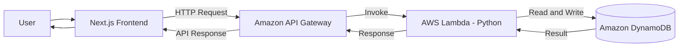

# CloudNotes

<button type="button" class="button primary" data-action="ask" data-icon="gitbook-assistant">Ask a question...</button>

### About CloudNotes

CloudNotes is a full-stack cloud-based notes management application that allows users to create, store, retrieve, update, and manage their notes through a web interface.

The project demonstrates the integration of modern web development with AWS serverless technologies. It uses a Next.js frontend, Python-based AWS Lambda functions, Amazon API Gateway, and Amazon DynamoDB to provide a scalable backend architecture.

#### What this project demonstrates

* Full-stack application development
* Python backend development using AWS Lambda
* REST API integration using Amazon API Gateway
* NoSQL database management with Amazon DynamoDB
* Cloud deployment and serverless architecture

<button type="button" class="button secondary" data-action="ask" data-query="How do I get started?" data-icon="rocket-launch">Get started</button><button type="button" class="button secondary" data-action="ask" data-query="How do I authenticate with the developer platform?" data-icon="key">Authenticate</button><button type="button" class="button secondary" data-action="ask" data-query="How do I integrate with my stack?" data-icon="code">Integrate</button><button type="button" class="button secondary" data-action="ask" data-query="How do I contribute?" data-icon="code-pull-request">Contribute</button>

&#x20;Technology Stack

| Layer          | Technology                |
| -------------- | ------------------------- |
| Frontend       | Next.js                   |
| Backend        | Python                    |
| API            | Amazon API Gateway        |
| Compute        | AWS Lambda                |
| Database       | Amazon DynamoDB           |
| Cloud Platform | Amazon Web Services (AWS) |

### System Architecture

CloudNotes follows a serverless architecture using AWS managed services. The frontend communicates with backend services through Amazon API Gateway. AWS Lambda processes requests and interacts with Amazon DynamoDB to store and retrieve notes.

### Project Features

CloudNotes provides a simple and efficient way to manage notes using a modern web interface and AWS cloud services.

#### 1. Create Notes

Create new notes by entering the required information through the application interface.

#### 2. View Notes

Retrieve and display saved notes from the cloud database.

#### 3. Update Notes

Edit existing notes and save the updated information.

#### 4. Delete Notes

Delete notes that are no longer required.

#### 5. REST API Integration

Communicate between the frontend and backend using HTTP requests through Amazon API Gateway.

#### 6. Serverless Backend

Execute backend operations using Python-based AWS Lambda functions without managing traditional servers.

#### 7. Cloud Database

Store and retrieve application data using Amazon DynamoDB.

#### 8. Responsive User Interface

Access the application through a web interface built with Next.js.

#### 9. Error Handling

Handle API and database errors and return appropriate responses to the frontend.

#### 10. Automated Testing

Use Python tests to verify backend functionality and help maintain application reliability.

### Project Repository

The source code and implementation of CloudNotes are available on GitHub.

**GitHub:** [https://github.com/jebickson/CloudNotes-sam](https://github.com/jebickson/CloudNotes-sam)

#### Project Information

* Project: CloudNotes
* Type: Full-Stack Cloud Application
* Backend: Python
* Cloud Platform: AWS
* Architecture: Serverless

#### Documentation Purpose

This documentation explains the project's architecture, technology stack, frontend, backend, database, API integration, testing, and deployment process.

&#x20;

&#x20;

&#x20;
